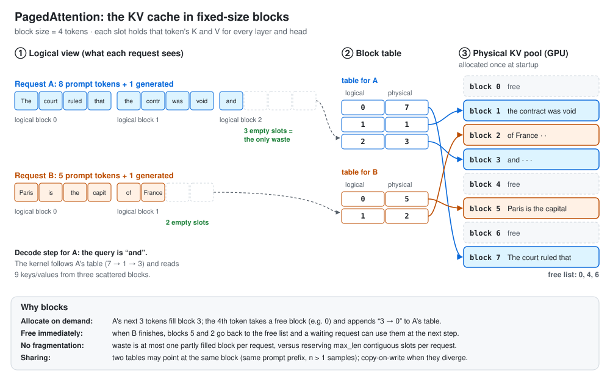

Training a language model and generating text with it run the same layers, but they are different workloads. Training sees the whole sequence at once. Generation produces one token at a time, and without a trick it would redo almost all of its work at every step. The trick is the **KV cache**, and once you have it, most of what an inference engine like vLLM does is managing it: how big it is, who gets to use it, and how to avoid wasting it.

This post builds it up from one attention layer to continuous batching and PagedAttention, with PyTorch code that runs on a CPU and numbers you can check by hand.

## Training doesn't need a KV cache

Training uses teacher forcing: the whole sequence is known, so all T tokens go through the model in one forward pass, with a causal mask so that token i only attends to tokens ≤ i. Every token's keys and values are computed exactly once in that pass, and nothing comes later that could reuse them. (They are kept for the backward pass, but as ordinary activations, not as a cache.)

Generation is different. To produce token 101, the model needs attention over tokens 1–100; for token 102, over 1–101. Without a cache, every step recomputes the keys and values of every earlier token. With a cache, each token's keys and values are computed once and stored.

One exception on the training side: **RL post-training** (PPO, GRPO) generates rollouts inside the training loop, and that generation is inference, KV cache included.

## Queries, keys and values: who is who

Every token produces all three vectors in every attention layer:

- the **query**: what this token is looking for,
- the **key**: what this token offers to be matched against,
- the **value**: what this token passes on if it is matched.

What changes between phases is which tokens' queries you need:

| Phase | Queries | Keys and values |
|---|---|---|
| Training | every token | every token (causal mask) |
| Prefill | every prompt token | every prompt token (causal mask); written to the cache |
| Decode | only the newest token | every earlier token, read from the cache, plus the newest token's own |

So "the query is the new token" is true in decode. In training and prefill, every token is a query and a key and a value at the same time.

## Prefill and decode

Generating text is exactly two phases: **inference = prefill + decode**. Prefill runs once per request; decode runs once per generated token. (Around them sit tokenization, sampling and detokenization, which are cheap. A request that only scores text, such as computing log-probabilities of a fixed answer, is prefill alone.)

**Prefill** processes the prompt. It is known in advance, so all its tokens go through in parallel, exactly like a training forward pass. The key idea: **prefill is one large matrix multiplication per layer, [prompt tokens × hidden] × [hidden × hidden], which computes the keys and values of every prompt token at once and writes them into the KV cache.** Large matrix multiplies are what GPUs do best, so prefill is limited by compute, not memory. It is efficient but not free: attention grows with the square of the prompt length, so a 100K-token prompt can take seconds. Prefill produces two things: the KV cache for the whole prompt and the first generated token.

**Decode** produces every later token, one per step:

```text
query  = the token generated last step          shape [batch, heads, 1, head_dim]
keys   = cached K of all earlier tokens + this token's own K (appended first)
values = cached V of all earlier tokens + this token's own V
attention → MLP → LM head → next token, which becomes the next step's query
```

Each decode step does very little arithmetic but has to read every weight of the model and the sequence's whole KV cache. Decode is limited by memory bandwidth, not compute. That fact drives everything below.

## A KV cache in PyTorch

One attention layer. It runs a prefill of 6 tokens, then decodes 4 tokens one at a time, and checks the result against plain causal attention over all 10 tokens:

```python
import torch, torch.nn as nn, torch.nn.functional as F
torch.manual_seed(0)
d, H = 64, 4                      # hidden size, heads
hd = d // H                       # head dim
Wq, Wk, Wv, Wo = (nn.Linear(d, d, bias=False) for _ in range(4))

def heads(x):                     # [B, T, d] -> [B, H, T, hd]
    B, T, _ = x.shape
    return x.view(B, T, H, hd).transpose(1, 2)

def merge(o):                     # [B, H, T, hd] -> [B, T, d]
    B, _, T, _ = o.shape
    return o.transpose(1, 2).reshape(B, T, d)

# Training / no cache: every token is a query at once, the causal mask hides the future.
def attn_full(x):
    q, k, v = heads(Wq(x)), heads(Wk(x)), heads(Wv(x))
    return Wo(merge(F.scaled_dot_product_attention(q, k, v, is_causal=True)))

# Inference with a cache: only the NEW tokens are computed; old K/V are reused.
class KVCache:
    def __init__(self):
        self.k = self.v = None    # [B, H, T_so_far, hd]
    def append(self, k, v):
        self.k = k if self.k is None else torch.cat([self.k, k], dim=2)
        self.v = v if self.v is None else torch.cat([self.v, v], dim=2)
        return self.k, self.v

def attn_cached(x_new, cache):    # x_new: [B, t, d], the t newest tokens only
    q = heads(Wq(x_new))                                       # queries: new tokens
    k, v = cache.append(heads(Wk(x_new)), heads(Wv(x_new)))    # keys/values: old + new
    t, T = q.shape[2], k.shape[2]
    mask = torch.ones(t, T, dtype=torch.bool).tril(diagonal=T - t)  # new token i sees the cache + new tokens ≤ i
    return Wo(merge(F.scaled_dot_product_attention(q, k, v, attn_mask=mask)))

x = torch.randn(1, 10, d)         # 10 token embeddings: 6 "prompt" + 4 "generated"
with torch.no_grad():
    ref = attn_full(x)
    cache = KVCache()
    outs = [attn_cached(x[:, :6], cache)]          # PREFILL: 6 queries, writes 6 K/V
    for i in range(6, 10):                         # DECODE: 1 query per step
        outs.append(attn_cached(x[:, i:i + 1], cache))
    out = torch.cat(outs, dim=1)
print("max |cached - full| =", (out - ref).abs().max().item())
```

```text
max |cached - full| = 7.5e-08
```

The cached version gives the same answer while computing each token's K and V once. A real model keeps one such cache per layer. (In real generation the decode input is the embedding of the token just sampled; feeding the known x here lets us compare against the full computation.)

## How big is the cache?

```text
bytes per token = 2 (K and V) × layers × kv_heads × head_dim × bytes per value
```

For Llama-3-8B (32 layers, 8 KV heads, head dimension 128, BF16): 2 × 32 × 8 × 128 × 2 = 131,072 bytes, **128 KB per token**. A 4K-token sequence needs 0.5 GB; a 128K-token sequence needs 16 GB, more than the model's own weights.

That is why model designs work hard to shrink it:

- **Multi-query and grouped-query attention (MQA, GQA)** share each key/value head across several query heads. Llama-3-8B's 8 KV heads for 32 query heads make its cache 4× smaller.
- **Multi-head latent attention (MLA)**, from DeepSeek-V2, caches a small compressed vector per token instead of full keys and values; the paper reports a 93.3% smaller KV cache.
- **Sliding-window, sparse and hybrid attention** keep keys and values for only some tokens, or only in some layers.
- **FP8 KV cache** halves the bytes for any model.

### MLA: how does decode get full-size keys and values back?

MLA caches one small latent vector per token, c = W_DKV · h, instead of full keys and values. The keys and values are linear functions of it: k_i = W_UK,i · c and v_i = W_UV,i · c for head i. There are two ways to use that in decode.

**Expand.** Multiply every cached latent by W_UK and W_UV at every step to rebuild full K and V, then run normal attention. That works, but it rebuilds T full-size keys and values per step, which is the very memory and bandwidth the latent was meant to save.

**Absorb** (what real engines do in decode). Because everything is linear, the up-projections can be moved off the cache:

```text
score  = q_i · k_t = q_i · (W_UK,i c_t) = (W_UK,iᵀ q_i) · c_t        → fold W_UK into the query
output = Σ_t p_t v_t = W_UV,i (Σ_t p_t c_t)                         → fold W_UV into the output projection
```

So the new token's query is projected into latent space once, attention is computed directly against the cached latents, and the weighted sum of latents is projected up once at the end. Full-size keys and values are never built. In effect, every head attends over one shared 512-dimensional "key = value" vector per token, like multi-query attention with a wide head. Prefill is compute-bound, so engines usually take the expand path there and the absorbed path in decode.

One catch is rotary position embeddings (RoPE). They rotate the key by a position-dependent matrix that sits between q and W_UK, so W_UK can't be folded into the query. DeepSeek-V2 therefore splits each key into two parts: a part with no position information, built from the latent, and a small extra RoPE key (64 dimensions) shared by all heads and cached next to the latent. Per token and per layer, DeepSeek-V2 caches 512 + 64 = 576 numbers, against 2 × 128 heads × 128 = 32,768 for standard multi-head attention.

A check in PyTorch (RoPE part left out):

```python
c = h_past @ W_DKV.T                                   # KV CACHE: [T, dc]
q = torch.einsum("hkd,d->hk", W_Q, h_new)              # new token's query, per head
# (a) expand: rebuild full K, V from the latent
K = torch.einsum("hkc,tc->htk", W_UK, c); V = torch.einsum("hkc,tc->htk", W_UV, c)
p = torch.softmax(torch.einsum("hk,htk->ht", q, K) / dh**0.5, -1)
out_a = torch.einsum("dhk,hk->d", W_O, torch.einsum("ht,htk->hk", p, V))
# (b) absorb: query into latent space, attend over the latents, project up once
q_lat = torch.einsum("hkc,hk->hc", W_UK, q)
p2 = torch.softmax(torch.einsum("hc,tc->ht", q_lat, c) / dh**0.5, -1)
out_b = torch.einsum("dhk,hk->d", W_O, torch.einsum("hkc,hc->hk", W_UV, p2 @ c))
# max |out_a - out_b| = 4.5e-07
```

## Why batching helps decode

A decode step reads all the weights once, whatever the batch size. Batch 256 sequences and the same weight read serves all of them. The KV cache does not share like this: each sequence reads its own.

Where the step times come from, for an 8B model in BF16 on one H200 with 1K-token contexts:

```text
lower bound = bytes read ÷ memory bandwidth
weights: 8B params × 2 bytes = 16 GB;   16 GB ÷ 4.8 TB/s = 3.3 ms   ← no step can be faster than this

batch 1:   KV read 1K tokens × 128 KB = 0.13 GB (adds 0.03 ms);  compute 2 × 8B = 16 GFLOP (~0.02 ms)
           ideal 3.4 ms; real kernels reach ~80–90% of peak bandwidth, plus launch overhead → ~4 ms
batch 256: KV read 256 × 0.13 GB = 34 GB (now twice the weights);  16 + 34 = 50 GB → 10.5 ms ideal, ~13 ms real
           compute 2 × 8B × 256 = 4.1 TFLOP → ~4 ms at peak, ~7 ms real, partly overlapped with the reads
           plus attention and sampling overheads → ~15–20 ms
```

So 3.3 ms is the floor set by physics (every weight must cross the memory bus once), and ~4 ms is what real kernels achieve at batch 1. Both are memory-bound: the arithmetic takes a few percent of the time. Roughly:

```text
batch 1:    ~4 ms per step   →  250 tokens/s for that user,   250 tokens/s total
batch 256:  ~20 ms per step  →   50 tokens/s for each user, ~12,800 tokens/s total
```

At large batches the KV reads, not the weights, take most of the time, which is why the cache's size matters so much.

So the more sequences fit in memory at once, the higher the throughput, and what limits how many fit is the KV cache.

## Static batching and its waste

The simple approach: take a batch of prompts, pad them to the same length, and decode until every one is finished.

```text
request   prompt   tokens wanted
   0         5          3
   1         2          8
   2         7          2
   3         3          6
   4         4          4
static: pad all to 7, run 8 steps for all 5 → request 2 finished at step 2 but keeps its slot for 6 more
```

Two kinds of waste: padding, and finished sequences that hold their slot until the slowest one ends. Older servers also reserved KV memory for the maximum length up front, as one contiguous buffer per request, so most of the memory was reserved but never used. The vLLM paper measured existing systems using only 20–40% of their KV memory for actual tokens.

## Continuous batching

Orca (OSDI 2022) fixed the scheduling half: decide the batch **at every step**, not once per batch. A finished sequence leaves immediately; a waiting request joins at the next step. The GPU never runs a slot for a sequence that is done.

To make joining and leaving cheap, the memory has to be easy to hand out and take back. That is the job of PagedAttention.

## PagedAttention: the KV cache in blocks

vLLM (Kwon et al., SOSP 2023) borrowed the idea of virtual memory. The KV cache is one big pool of fixed-size **blocks** (16 tokens by default), allocated once at startup. Each request has a **block table** that maps its logical blocks (block 0 = tokens 0–15, block 1 = tokens 16–31, ...) to physical blocks anywhere in the pool.



*Block size 4 for readability. Request A has 9 tokens in three logical blocks, stored in physical blocks 7, 1 and 3. Request B has 6 tokens in blocks 5 and 2. When A decodes “and”, the attention kernel follows A's table and reads all 9 keys and values from three scattered blocks.*

What this buys:

- **Allocate on demand.** A sequence takes a new block only when its last one is full. The waste is at most one partly filled block per sequence.
- **Free immediately.** A finished sequence returns its blocks to the free list, and a waiting request can use them at the next step.
- **No fragmentation.** Blocks don't need to be contiguous, so any free block will do.
- **Sharing.** Two block tables can point at the same physical block: a shared system prompt, or n samples of the same prompt. A block is copied only when the sequences diverge (copy-on-write).

With little waste, more sequences fit, and the vLLM paper reports 2–4× the throughput of earlier systems at the same latency.

## A toy vLLM: continuous batching with a paged cache

Here is the core of a toy engine: a toy model (embedding, one attention layer, LM head, greedy decoding), a paged KV pool, and a scheduler that admits, preempts and retires requests at every step. `h` and `m` reshape to and from heads, like `heads` and `merge` above.

```python
BLOCK, NUM_BLOCKS = 4, 10                        # tiny pool: 10 blocks × 4 tokens
k_pool = torch.zeros(NUM_BLOCKS, H, BLOCK, hd)   # physical KV memory, allocated once
v_pool = torch.zeros(NUM_BLOCKS, H, BLOCK, hd)
free = list(range(NUM_BLOCKS))                   # free list

class Seq:
    def __init__(s, rid, prompt, n_new):
        s.rid, s.toks, s.n_prompt, s.n_new = rid, list(prompt), len(prompt), n_new
        s.blocks, s.n_cached = [], 0             # block table: logical j -> physical s.blocks[j]
    def done(s): return len(s.toks) - s.n_prompt >= s.n_new

def write_kv(s, k, v):                           # k, v: [H, t, hd] for positions n_cached, ...
    for j in range(k.shape[1]):
        pos = s.n_cached + j
        if pos // BLOCK == len(s.blocks): s.blocks.append(free.pop(0))   # allocate on demand
        b = s.blocks[pos // BLOCK]                                        # block table lookup
        k_pool[b, :, pos % BLOCK], v_pool[b, :, pos % BLOCK] = k[:, j], v[:, j]
    s.n_cached += k.shape[1]

def read_kv(s):                                  # gather this sequence's blocks via its table
    idx = torch.tensor(s.blocks)
    K = k_pool[idx].transpose(0, 1).reshape(H, -1, hd)[:, :s.n_cached]
    V = v_pool[idx].transpose(0, 1).reshape(H, -1, hd)[:, :s.n_cached]
    return K, V

def forward(s, new_toks):                        # run one sequence's new tokens, return next token
    x = emb(torch.tensor(new_toks)); q = h(Wq(x))
    write_kv(s, h(Wk(x)), h(Wv(x)))
    K, V = read_kv(s); t, T = q.shape[1], K.shape[1]
    mask = torch.ones(t, T, dtype=torch.bool).tril(T - t)
    return head(Wo(m(F.scaled_dot_product_attention(q, K, V, attn_mask=mask)))[-1]).argmax().item()

def blocks_needed(n): return -(-n // BLOCK)

def continuous_batch(requests, max_running=3):
    waiting, running, results = [Seq(*r) for r in requests], [], {}
    while waiting or running:
        # 1) admit while there is a batch slot AND enough free blocks for the prompt
        while waiting and len(running) < max_running and blocks_needed(len(waiting[0].toks) + 1) <= len(free):
            s = waiting.pop(0); running.append(s)
            s.toks.append(forward(s, s.toks))    # PREFILL: whole prompt at once, emits the 1st token
        # 2) out of blocks? preempt the newest sequence; it is recomputed when readmitted
        while running and sum(s.n_cached % BLOCK == 0 for s in running) > len(free):
            s = running.pop(); free.extend(s.blocks); s.blocks, s.n_cached = [], 0
            s.n_prompt, s.n_new = len(s.toks), s.n_new - (len(s.toks) - s.n_prompt)
            waiting.insert(0, s)
        # 3) DECODE one token for every running sequence
        for s in running:
            if not s.done(): s.toks.append(forward(s, [s.toks[-1]]))
        # 4) finished sequences leave now and give their blocks back
        for s in [s for s in running if s.done()]:
            running.remove(s); free.extend(s.blocks); results[s.rid] = s
    return results
```

Run on the five requests above, printing the batch and block tables after each step:

```text
step  1: batch=[0, 1, 2]  free blocks= 5  tables={0: [0, 1], 1: [2], 2: [3, 4]}
step  2: batch=[0, 1, 3]  free blocks= 6  tables={0: [0, 1], 1: [2], 3: [5]}           ← 2 left, 3 joined
step  3: batch=[1, 3, 4]  free blocks= 4  tables={1: [2, 7], 3: [5, 8], 4: [6, 9]}
step  4: batch=[1, 3, 4]  free blocks= 4  tables={1: [2, 7], 3: [5, 8], 4: [6, 9]}
step  5: batch=[1, 3, 4]  free blocks= 4  tables={1: [2, 7], 3: [5, 8], 4: [6, 9]}
step  6: batch=[1, 3]  free blocks= 6  tables={1: [2, 7], 3: [5, 8]}
step  7: batch=[1]  free blocks= 7  tables={1: [2, 7, 3]}
```

Every request's output matches decoding it alone. Shrink the pool to 4 blocks and you can watch preemption: a request is evicted when the blocks run out, then recomputed later, and the outputs still match. To keep the code readable, decode calls `forward` once per sequence. A real engine runs the whole batch in one kernel that follows each sequence's block table, and mixes prefill and decode tokens in the same step.

### Reading the code: a warehouse of lockers

`k_pool` and `v_pool` are the GPU memory that holds the KV cache of **every** request, allocated once before any request arrives. `k_pool[b, :, j]` is the key of one token (all heads) stored in slot `j` of block `b`; `v_pool[b, :, j]` is that token's value. The two pools always use the same address, and no block belongs to any request until the block table says so.

Think of a storage warehouse:

| Code | Warehouse |
|---|---|
| `k_pool`, `v_pool` | two identical buildings of lockers; locker 7 in the K building and locker 7 in the V building always belong to the same customer |
| a block (`NUM_BLOCKS = 10`) | one locker; 10 per building, built on opening day |
| `BLOCK = 4` | each locker has 4 shelves, one token's box per shelf |
| a token's K and V | two boxes: the key box in the K building, the value box in the V building, same locker, same shelf |
| `free` | the front desk's list of empty lockers |
| `Seq` | a customer (one request) |
| `s.blocks` (block table) | the customer's ticket, listing their lockers in order: "1st locker #2, 2nd locker #7" |
| `s.n_cached` | how many boxes the customer has stored so far |

The ticket is the key idea. A customer's lockers can be anywhere (#2 then #7, not side by side); the ticket keeps them in order, so the customer only ever thinks "my 1st locker, my 2nd locker".

**`write_kv` stores boxes.** Box number `pos` goes to ticket entry `pos // BLOCK`, shelf `pos % BLOCK`: box 5 is entry 1, shelf 1, and if the ticket says entry 1 is locker #7, it lands in locker 7, shelf 1. When all the customer's lockers are full (`pos // BLOCK == len(s.blocks)`), the desk hands out the next empty locker and writes it on the ticket. A customer can waste at most the empty shelves of their last locker.

**`read_kv` takes everything out.** Follow the ticket, open the lockers in order (`k_pool[idx]`), line the shelves up (`reshape`) and drop the empty shelves at the end (`[:, :s.n_cached]`). The result is exactly the contiguous `[H, T, hd]` cache that the simple `KVCache` class kept, assembled from scattered lockers. A real engine doesn't copy the boxes out: its attention kernel reads them in place by following the ticket.

**`forward` is one visit:** the new tokens make their queries, their key and value boxes go into the lockers, then all of the customer's boxes, old and new, are fetched for attention.

**`continuous_batch` is the front desk:**

- **Admit:** a new customer comes in only if there is a free service window (`max_running`) and enough empty lockers for their prompt; they drop off all their prompt boxes at once (prefill).
- **Decode:** every customer at a window adds one new box per round.
- **Finish:** a customer who is done hands back the ticket, and their lockers go straight onto the empty list, ready for the next customer in the very next round.
- **Preempt:** when lockers run out, the desk asks the newest customer to leave and empties their lockers. When they come back, they rebuild their boxes from their written notes, the tokens so far. That is the recompute.

The trace above reads the same way:

```text
step 1: tables={0: [0, 1], 1: [2], 2: [3, 4]}
  customer 0: 5 prompt + 1 generated = 6 boxes → lockers #0 (full) and #1 (2 of 4 shelves)
  customer 1: 2 + 1 = 3 boxes → locker #2
  customer 2: 7 + 1 = 8 boxes → lockers #3 and #4, both full
step 2: customer 2 is done; lockers #3 and #4 go back to the desk; customer 3 joins and gets #5
step 3: tables={1: [2, 7], 3: [5, 8], 4: [6, 9]}
  customer 1 filled locker #2 and was handed #7: not next to #2, and that is fine, the ticket remembers the order
```

A real vLLM differs in scale, not idea: each layer has its own pair of buildings and all layers share one ticket; K and V usually live in one tensor shaped `[2, num_blocks, block_size, kv_heads, head_dim]`; lockers have 16 shelves and there are hundreds of thousands of them, sized at startup from the leftover GPU memory; and two tickets can list the same locker when customers share a prompt prefix, with a copy made only when one of them needs to write something different.

## Why vLLM sizes the cache at startup

When vLLM starts, it measures the weights and the peak activation memory, and turns everything left under `gpu_memory_utilization` into KV blocks. The log reports the number of blocks and the maximum concurrency for your `max_model_len`. For Llama-3-8B on one H200:

```text
141 GB × 0.9 = 127 GB
− 16 GB weights − ~6 GB activations ≈ 105 GB for KV
105 GB ÷ 128 KB per token ≈ 800K tokens ≈ 200 sequences of 4K tokens at once
```

That figure is a budget for **all tokens in flight across all requests**, not a per-request limit. Computing it up front does three things:

1. **One allocation.** The pool is a single tensor created at startup: no allocation while serving, no fragmentation, and fixed addresses, which CUDA graphs need.
2. **A budget for the scheduler.** "Admit this request?" and "preempt someone?" are both answered by counting free blocks.
3. **Fail fast.** If one request of `max_model_len` tokens can't fit, vLLM refuses to start instead of failing in the middle of a run.

When the budget is full, new requests wait in the queue and running ones may be preempted. You control it with `gpu_memory_utilization` (the size of the budget), `max_model_len` (the most tokens one request may have), `max_num_seqs` (batch slots) and `max_num_batched_tokens` (tokens per step).

## Offline and serving are the same engine

`LLM.generate(prompts)` does not form a fixed batch. It adds every prompt to the engine's waiting queue, then calls `engine.step()` until nothing is left (vLLM's `_run_engine`). At each step the scheduler does what the toy engine above does: it admits waiting requests while there are free batch slots (`max_num_seqs`), token budget and KV blocks, decodes the running ones, and retires the finished ones. So it **does** add new sequences: pass 10,000 prompts and roughly 256 run at once; whenever one finishes, the next prompt from your list takes its place at the next step. Only at the end, once the queue is empty, does the batch just drain. That is the same continuous batching `vllm serve` uses; the queue is filled by your list instead of by HTTP requests.

The differences are where requests come from and what you optimize:

- **Offline** (a dataset, an evaluation, RL rollouts): all requests are known up front and nobody waits on any single answer. Only the total time matters, so you want maximum **throughput**: the biggest batch the KV cache allows.
- **Serving**: people are waiting. What matters is **latency** per request: time to first token (queueing plus prefill) and time per output token (the step time). You cap `max_num_seqs` and use chunked prefill so a long prompt doesn't stall everyone else's decoding, giving up some total throughput for each user's experience.

## SGLang: keep the cache, organize it as a tree

SGLang (Zheng et al., 2023) is the other major open-source engine. It shares vLLM's foundation: continuous batching, a paged KV pool, chunked prefill, speculative decoding, tensor/data/expert parallelism. The difference is what happens to the KV cache **after** a request finishes.

**RadixAttention.** vLLM's original design freed a finished request's blocks. SGLang keeps them, indexed by a **radix tree** whose edges are token sequences and whose nodes point to KV slots:

```text
                  [system prompt "You are a helpful assistant…"]      ← one copy of its KV, shared
                    /                                      \
     ["Translate to French: …"]                      ["Summarize: …"]
          /              \                                  |
   [answer A]    [follow-up turn + answer B]             [answer C]
```

When a request arrives, the engine walks the tree to find the longest prefix it has already computed, reuses that KV, and prefills only the rest. Nodes in use by running requests are reference-counted and protected; when memory runs out, unused leaves are evicted, least recently used first. The pool is paged with a page size of 1 token by default, so a prefix can match at any length.

Today vLLM keeps finished requests' KV too. With automatic prefix caching (on by default), a finished request's blocks go back on the free list but keep their contents and a hash of their tokens; a later request whose prefix hashes the same reuses them, and a block is overwritten only when a new request needs the memory, least recently used first. So the remaining difference in reuse is the lookup: vLLM matches whole 16-token blocks through a hash table, SGLang matches any number of tokens through the tree.

Is keeping old KV a waste when no later request shares the prefix? Hardly. Cached entries live only in memory that no running request needs, and they are evicted the moment a new request needs space. With no sharing you gain nothing and lose a few microseconds of lookup per request, which is why both engines leave it on (vLLM `--no-enable-prefix-caching` and SGLang `--disable-radix-cache` turn it off).

**Cache-aware scheduling.** Optionally, SGLang picks the next request by how much of its prompt is already cached instead of by arrival time (longest prefix match, explained step by step below). The paper reports up to 6.4× the throughput of earlier systems on workloads with heavy sharing.

**A frontend language.** SGLang began as a way to write multi-call LLM programs (`gen`, `select`, `fork`, `join`). `fork` launches several continuations of the same prefix, and the runtime knows they share it.

**Faster structured output.** For JSON or regex constraints, a compressed finite-state machine lets the engine emit several forced tokens in one step ("jump-forward" decoding) instead of one per step.

**An overlapped scheduler.** The CPU prepares the next batch while the GPU runs the current one, so scheduling overhead disappears from the step time.

| | vLLM | SGLang |
|---|---|---|
| Memory | PagedAttention, 16-token blocks | paged pool, 1-token pages by default |
| Prefix reuse | automatic prefix caching: each full block is hashed by its tokens and its parent's hash; only full blocks are reused | radix tree over tokens; any prefix length; reuse across requests is the core design |
| Scheduling | first come, first served (priorities optional) | first come, first served by default; `--schedule-policy lpm` picks the longest cached prefix first |
| Origin | serving engine | structured LLM programs plus a runtime |

The gap has narrowed: vLLM's prefix caching is on by default in its current engine, and both now use the same grammar libraries and attention kernels. SGLang still tends to win when many requests share prefixes: agents, multi-turn chat, few-shot prompts, tree search, and GRPO's n samples per prompt, which is one reason RL frameworks such as slime use it for rollouts. verl supports both engines.

### Longest prefix match, step by step

Both engines use continuous batching: neither runs "the first 100 requests, then the next 100". With 1000 requests and 100 slots, the first 100 are admitted, and each time one finishes, a waiting request takes its slot at the next step. The scheduling policy only decides **which** waiting request takes the slot, and only matters when more requests wait than there are free slots. vLLM takes the one that arrived first. SGLang does the same by default; with `--schedule-policy lpm` (longest prefix match) it takes the one with the most tokens already cached.

"Longest prefix" does not mean the longest prompt. It means the longest part of a request's prompt whose KV is already in the tree. For each waiting request, the scheduler walks down the radix tree with the request's tokens for as long as they agree; the number of tokens matched is the request's **match length**. Suppose the tree holds:

```text
root
 └─ [system prompt A: 500 tokens]
      ├─ [few-shot examples: 300 tokens]
      │     └─ [question 7 + answer]          ← from a finished request
      └─ [question 3 + answer]
```

and four requests wait, in this arrival order:

| Request | Prompt | Length | Match length (already cached) |
|---|---|---|---|
| r1 | new system prompt B + question | 900 | 0 |
| r2 | A + new question | 540 | 500 (A) |
| r3 | A + few-shot + new question | 830 | 800 (A + few-shot) |
| r4 | short new prompt | 20 | 0 |

Sorted by match length: r3 (800), r2 (500), r1 (0), r4 (0), ties in arrival order. r1 is the longest prompt but goes third, because none of it is cached. What happens to r3 when it is admitted:

1. **Lock** the matched nodes (A and few-shot) by raising their reference counts, so they can't be evicted while r3 runs.
2. **Allocate** KV slots only for the unmatched tail: 30 tokens, not 830.
3. **Prefill** only those 30 tokens; their queries attend to the 800 cached keys and values plus their own, the same cache-plus-new-tokens attention as `attn_cached` above.
4. **Decode** as usual.
5. **Insert** r3's new tokens into the tree as a child of the few-shot node and release the locks; its KV stays cached until evicted, least recently used first.

r3's prefill shrinks from 830 tokens to 30, and r2's from 540 to 40.

Nobody tells SGLang which requests belong together; the grouping falls out of re-sorting at every step. Take 1000 waiting requests that use 10 system prompts, A to J, none cached yet:

```text
step 1: every match length is 0 → admit in arrival order; one A request runs and A enters the tree
step 2: every waiting A request now matches 500 tokens, the rest 0 → the A requests jump the queue
...     A requests run back to back while A is cached; then a B request gets cached, and so on
```

The first request of each group pays for its prefix; the rest reuse it. One refinement handles step 1: if several waiting requests share a prefix that is not cached yet, SGLang admits one of them and holds the others back for a round ("in-batch prefix caching", for shared prefixes of 32+ tokens), so they hit the cache instead of all computing the same prefix side by side.

In pseudocode:

```python
def pick_next(waiting, tree, free_slots, free_tokens):
    for r in waiting:
        r.match = tree.match_prefix(r.tokens)        # walk the radix tree
    waiting.sort(key=lambda r: -r.match)             # longest cached prefix first (stable: ties keep arrival order)
    batch = []
    for r in waiting:
        need = len(r.tokens) - r.match               # only the unmatched tail needs new KV
        if len(batch) < free_slots and need <= free_tokens:
            tree.lock(r.match_nodes); batch.append(r); free_tokens -= need
    return batch
```

Two costs. Matching every waiting request against the tree at every step is expensive for a long queue, so when more than 128 requests wait, SGLang switches back to first come, first served (`WAITING_QUEUE_PREFIX_MATCH_MAX = 128` in `schedule_policy.py`). And it is less fair: a request whose prefix nothing else shares can wait longer.

## Speculative decoding

Decode is memory-bound: one step reads every weight to produce one token per sequence. Scoring several tokens in the same pass costs barely more, because the weights are read once either way. Speculative decoding (Leviathan et al., 2022; Chen et al., 2023) uses that slack: a small, fast **draft** model guesses the next k tokens, and the large **target** model checks all k in one pass.

Both models first prefill the prompt, each into its **own** KV cache: a model can only use keys and values it computed itself. Then each round goes like this:


*One round with k = 4. The draft model guesses four tokens, one cheap step each. The target model runs one pass over the last accepted token plus the four guesses and predicts the next token at every position. The guesses are accepted while they agree; at the first disagreement the target's token is used instead, and everything after it is thrown away, from both the output and both KV caches.*

### What "scoring" is

The target model's verification is one forward pass over k+1 tokens, `[the, mat, and, fell, asleep]`: k+1 queries attending causally to the target's cache plus these tokens, exactly like a small prefill. It returns a next-token prediction at **every** position:

```text
position:            the     mat     and      fell     asleep
target predicts:     mat     and     purred   asleep   .
draft guessed:       mat ✓   and ✓   fell ✗
```

Output i is the target's choice given the text plus guesses 1…i. Scoring is a left-to-right comparison: accept guesses while they equal the target's choice, and at the first mismatch take the target's token instead. Here one pass yields three tokens: "mat", "and" and the correction "purred". If all k guesses agree, the round yields k + 1 tokens: the k guesses plus a bonus token from the last position. A round never yields fewer than one token, so the output can't be worse than decoding with the target alone, only faster.

### When a token is wrong: the KV cache and the later guesses

Two consequences of replacing "fell" with "purred":

- **The KV cache is wrong only from that position on.** Attention is causal, so a position's keys and values depend only on the tokens at or before it. The entries for "the mat and" were built on correct tokens and stay. The entries for "fell" and "asleep" were built on a wrong token and are simply cut off the end of the cache: set its length back, recompute nothing. "purred" is not in either cache yet; it is the first input of the next round, as "the" was in this one.
- **Every later guess is meaningless.** "asleep" was guessed after "fell", and the target's predictions after the mismatch were computed after "fell" too. So everything past the first mismatch is discarded, even a later guess that happens to match. The draft model then guesses again starting from "purred".

### The code

Two tiny models with truncatable KV caches, greedy decoding, checked against the target decoding alone. The draft is a stand-in: a copy of the target that guesses wrong about 30% of the time on purpose, which makes the accept and reject paths easy to see.

```python
"""Greedy speculative decoding with KV caches, checked against plain greedy decoding of the big model."""
import torch, torch.nn as nn, torch.nn.functional as F
torch.manual_seed(0)
V, d = 20, 32

class TinyLM(nn.Module):
    """embedding -> 1 causal attention layer -> LM head, with a KV cache that can be cut back."""
    def __init__(s):
        super().__init__()
        s.emb, s.q, s.k, s.v, s.out = nn.Embedding(V, d), nn.Linear(d, d), nn.Linear(d, d), nn.Linear(d, d), nn.Linear(d, V)
        s.K = s.Vc = None
    def forward(s, toks):                        # toks: the NEW tokens only -> logits for each of them
        x = 3 * s.emb(torch.tensor(toks)) + 0.05 * torch.arange(len(toks) + s.cached())[-len(toks):, None]
        k, v = s.k(x), s.v(x)
        s.K = k if s.K is None else torch.cat([s.K, k]); s.Vc = v if s.Vc is None else torch.cat([s.Vc, v])
        t, T = len(toks), len(s.K)
        mask = torch.ones(t, T, dtype=torch.bool).tril(T - t)
        return s.out(F.scaled_dot_product_attention(s.q(x)[None], s.K[None], s.Vc[None], attn_mask=mask)[0])
    def cached(s): return 0 if s.K is None else len(s.K)
    def truncate(s, n): s.K, s.Vc = s.K[:n], s.Vc[:n]   # throw away K/V of positions >= n

target = TinyLM()
draft = TinyLM(); draft.load_state_dict(target.state_dict())
# Stand-in for a small model: same weights (its own cache), but ~30% of its guesses are wrong on purpose.
rng = torch.Generator().manual_seed(1)
def draft_guess(logits):
    g = logits.argmax().item()
    return (g + 1) % V if torch.rand(1, generator=rng).item() < 0.3 else g

def greedy(model, prompt, n):                    # reference: big model alone, one token per step
    model.K = model.Vc = None; toks = list(prompt); nxt = model(toks)[-1].argmax().item()
    for _ in range(n):
        toks.append(nxt); nxt = model([nxt])[-1].argmax().item()
    return toks[len(prompt):]

def speculative(prompt, n, k=4):
    target.K = target.Vc = draft.K = draft.Vc = None
    toks = list(prompt)
    target(toks[:-1]); draft(toks[:-1])          # PREFILL both models (all but the last prompt token)
    passes = 0
    while len(toks) - len(prompt) < n:
        start = len(toks) - 1                    # position of the last accepted token (not yet in either cache)
        # 1) DRAFT: small model proposes k tokens, one at a time (cheap)
        guess, last = [], toks[-1]
        for _ in range(k):
            last = draft_guess(draft([last])[-1]); guess.append(last)
        # 2) VERIFY: big model scores [last accepted token + k guesses] in ONE forward pass
        logits = target([toks[-1]] + guess)      # k+1 queries, like a small prefill
        want = logits.argmax(-1).tolist()        # want[i] = big model's choice after (toks + guess[:i])
        passes += 1
        # 3) ACCEPT the longest agreeing prefix, then take the big model's token at the first mismatch
        a = 0
        while a < k and guess[a] == want[a]: a += 1
        new = guess[:a] + [want[a]]              # a accepted guesses + 1 token from the big model
        print(f"pass {passes}: draft {guess} | target wants {want} | accept {a} → emit {new}")
        toks += new
        # 4) ROLL BACK both caches to the accepted prefix: K/V after the mismatch were built on wrong tokens
        keep = start + 1 + a                     # last accepted token + a accepted guesses
        target.truncate(keep)
        if a == k: draft([guess[-1]])            # all accepted: the draft never fed its own last guess, add it
        draft.truncate(keep)
    return toks[len(prompt):len(prompt) + n], passes

prompt, n = [3, 1, 4, 1, 5], 16
with torch.no_grad():
    ref = greedy(target, prompt, n)
    out, passes = speculative(prompt, n)
print("same output as the big model alone:", out == ref, f"| {n} tokens in {passes} big-model passes instead of {n}")
```

```text
pass 1: draft [2, 16, 13, 2] | target wants [2, 15, 13, 2, 18] | accept 1 → emit [2, 15]
pass 2: draft [3, 18, 18, 18] | target wants [2, 18, 18, 18, 18] | accept 0 → emit [2]
pass 3: draft [15, 2, 15, 2] | target wants [15, 2, 15, 2, 15] | accept 4 → emit [15, 2, 15, 2, 15]
pass 4: draft [2, 15, 2, 15] | target wants [2, 15, 2, 15, 2] | accept 4 → emit [2, 15, 2, 15, 2]
pass 5: draft [15, 2, 18, 18] | target wants [15, 2, 18, 18, 18] | accept 4 → emit [15, 2, 18, 18, 18]
same output as the big model alone: True | 16 tokens in 5 big-model passes instead of 16
```

Pass 1 shows the point about later guesses: the draft's third guess (13) matches the target's third prediction, yet it is discarded, because that prediction assumed the second token was 16.

The cache bookkeeping is easy to get wrong. A first version left out the line `if a == k: draft([guess[-1]])`. When all k guesses are accepted, the draft model has never fed its own last guess back in, so its cache is one token short and every later guess goes wrong. The output was still correct, since the target fixes every mistake, but nearly every guess was rejected. A test with a draft identical to the target, which should accept every guess, caught it.

### Where the time is saved

The target model does just as much arithmetic as before, in fact more: it computes every rejected guess and throws it away. Speculative decoding doesn't save computation. It saves **time**, because a decode step's time goes into reading the weights from memory, not into arithmetic.

One decode step for an 8B model in BF16 on an H200, batch 1:

| | 1 token (normal decode) | 5 tokens (verify pass) |
|---|---|---|
| Read the weights (16 GB at 4.8 TB/s) | 3.3 ms | 3.3 ms, read once and used for all 5 tokens |
| Read the KV cache (1K tokens) | 0.03 ms | 0.03 ms, all 5 queries share one read |
| Compute (2 × 8B FLOPs per token, at ~989 TFLOP/s) | 0.02 ms | 0.08 ms |
| **Total (real kernels)** | **~4.0 ms** | **~4.1 ms** |

The arithmetic is under 2% of the step; the GPU spends the step waiting for weights to arrive. Once a weight is loaded, multiplying it against 5 tokens instead of 1 is nearly free, and that spare capacity is what speculative decoding uses.

Think of a delivery truck. The cost of a trip is the drive (reading the weights), whether the truck carries 1 box or 5. Normal decoding makes one trip per box. Speculative decoding sends a scout on a scooter (the draft) to guess the next 4 boxes; the truck carries all 5 in one trip, and the wrong ones are sent back. You save trips, not boxes.

Now the whole run: 100 tokens, an 8B target at ~4.0 ms per step, a 1B draft at ~0.8 ms per step (small models don't reach full bandwidth; kernel launches dominate), k = 4 and an acceptance rate α = 0.7, which gives (1 − α⁵) / (1 − α) ≈ 2.77 tokens per round:

```text
target only:   |T|T|T|T|T|T|T|T|T|T| …        100 passes × 4.0 ms               = 400 ms
speculative:   |d|d|d|d|  V  |d|d|d|d|  V  | …  36 rounds × (4 × 0.8 + 4.1) ms   = 264 ms   ≈ 1.5× faster
```

| | Target only | Speculative | Change |
|---|---|---|---|
| Target passes | 100 | 36 | **−64%** |
| Weight bytes read | 100 × 16 GB = 1.6 TB | 36 × 16 GB + 144 draft steps × 2.5 GB = 0.94 TB | **−41%** |
| Target FLOPs | 100 × 16 GFLOP = 1.6 TFLOP | 36 × 5 tokens × 16 GFLOP = 2.9 TFLOP | **+80%** (rejected guesses are computed, then discarded) |
| Time | 400 ms | 264 ms | **−34%** |

The target does 80% more arithmetic, but 2.9 TFLOP takes about 3 ms on an H200, out of 264 ms. The whole saving comes from reading the 16 GB of weights 36 times instead of 100.

### When it pays off

```text
speedup = expected tokens per round / (k × c + 1)
c = draft step time ÷ target step time        (a verify pass ≈ 1 target step)
```

| Case | c | α | Speedup |
|---|---|---|---|
| 8B target, 1B draft (above) | 0.2 | 0.7 | 2.77 / 1.8 ≈ **1.5×** |
| 70B target on 4 GPUs (~10 ms per step), 1B draft | 0.08 | 0.7 | 2.77 / 1.32 ≈ **2.1×** |
| Same 70B, a draft that agrees more often | 0.08 | 0.85 | 3.71 / 1.32 ≈ **2.8×** |
| A poor draft | 0.2 | 0.3 | 1.42 / 1.8 ≈ **0.8×, slower** |

Three conditions:

1. **The draft is much cheaper than the target** (small c), which is why big targets gain the most.
2. **The draft agrees often** (high α). Code, translation and copying from the prompt work well; creative text at high temperature doesn't.
3. **The batch is small.** At batch 256 the verify pass covers 256 × 5 = 1280 tokens, the step becomes compute-bound, the extra positions stop being free, and the gain disappears. Serving engines often switch speculative decoding off under heavy load.

These numbers are calculated from the H200's bandwidth and peak FLOPs, like the step times earlier in the post, not measured.

Drafts come in several kinds: a smaller model of the same family; extra prediction heads on the target itself (Medusa, EAGLE); DeepSeek-V3's multi-token prediction module; or no model at all, matching n-grams from the prompt ("prompt lookup"), which works well when the output copies the input, as in code editing. vLLM and SGLang support these through their speculative decoding options.

### With sampling instead of greedy

Engines usually sample, so "equal" becomes a coin flip. With q the draft's probability for its token x and p the target's:

- accept x with probability min(1, p(x) / q(x));
- if rejected, sample a replacement from max(0, p − q), renormalized, and stop the round there.

This rule makes the output distribution **exactly** the target's (Leviathan et al.; Chen et al.). Greedy is the special case in which both distributions put all their mass on one token.

## Related ideas

- **Chunked prefill** (Sarathi-Serve): split a long prompt's prefill into chunks and mix them into steps with ongoing decodes.
- **Prefix caching**: requests with the same prefix (a system prompt, earlier chat turns, n samples of one prompt) reuse the same KV blocks; vLLM hashes full blocks, SGLang uses the radix tree above.
- **Tensor parallelism splits KV heads**: each GPU stores kv_heads / t heads. With more GPUs than KV heads, heads are duplicated. MLA has no heads to split, so engines use data-parallel attention instead: each GPU holds the full cache of its own requests.
- **Prefill/decode disaggregation** (DistServe, Splitwise): prefill on some GPUs, decode on others, and the KV cache is sent over the network in between.
- **Vision-language models**: image tokens occupy the cache like text tokens, so a few images can cost as much as thousands of words.
- **RL post-training**: rollout engines share GPUs with the trainer, so their KV memory competes with training memory. Frameworks free the KV cache (and the inference weights) before each training step.

## Cheat sheet

| Idea | What it does | Why |
|---|---|---|
| KV cache | store each token's keys and values once | decode would otherwise recompute them every step |
| Prefill | one large matmul per layer computes K and V for all prompt tokens; fills the cache | compute-bound, one big pass |
| Decode | one query per step against the cache | memory-bound: reads weights and the cache |
| Batching | many sequences share one read of the weights | throughput |
| Continuous batching | rebuild the batch every step | no slots held by finished sequences |
| PagedAttention | fixed blocks plus block tables | no fragmentation, free sharing, more sequences fit |
| Token budget | KV pool sized at startup | one allocation, scheduler budget, fail fast |
| GQA, MLA, FP8 KV | smaller bytes per token | more tokens fit |
| MLA absorption | fold W_UK into the query and W_UV into the output | decode never rebuilds full K and V |
| Speculative decoding | a cheap draft guesses k tokens, the target checks them in one pass | several tokens per memory-bound pass, same output |
| RadixAttention (SGLang) | keep finished requests' KV in a prefix tree | reuse across requests with shared prefixes |

## References

- Vaswani et al., *Attention Is All You Need*, 2017. [arXiv:1706.03762](https://arxiv.org/abs/1706.03762)
- Shazeer, *Fast Transformer Decoding: One Write-Head is All You Need* (MQA), 2019. [arXiv:1911.02150](https://arxiv.org/abs/1911.02150)
- Ainslie et al., *GQA*, 2023. [arXiv:2305.13245](https://arxiv.org/abs/2305.13245)
- Yu et al., *Orca: A Distributed Serving System for Transformer-Based Generative Models*, OSDI 2022. [usenix.org](https://www.usenix.org/conference/osdi22/presentation/yu)
- Kwon et al., *Efficient Memory Management for Large Language Model Serving with PagedAttention*, 2023. [arXiv:2309.06180](https://arxiv.org/abs/2309.06180)
- Agrawal et al., *Sarathi-Serve*, 2024. [arXiv:2403.02310](https://arxiv.org/abs/2403.02310)
- Zheng et al., *SGLang* (RadixAttention), 2023. [arXiv:2312.07104](https://arxiv.org/abs/2312.07104)
- Leviathan et al., *Fast Inference from Transformers via Speculative Decoding*, 2022. [arXiv:2211.17192](https://arxiv.org/abs/2211.17192)
- Chen et al., *Accelerating Large Language Model Decoding with Speculative Sampling*, 2023. [arXiv:2302.01318](https://arxiv.org/abs/2302.01318)
- Cai et al., *Medusa*, 2024. [arXiv:2401.10774](https://arxiv.org/abs/2401.10774)
- Li et al., *EAGLE*, 2024. [arXiv:2401.15077](https://arxiv.org/abs/2401.15077)
- Zhong et al., *DistServe*, 2024. [arXiv:2401.09670](https://arxiv.org/abs/2401.09670)
- Patel et al., *Splitwise*, 2023. [arXiv:2311.18677](https://arxiv.org/abs/2311.18677)
- DeepSeek-AI, *DeepSeek-V2* (MLA), 2024. [arXiv:2405.04434](https://arxiv.org/abs/2405.04434)
